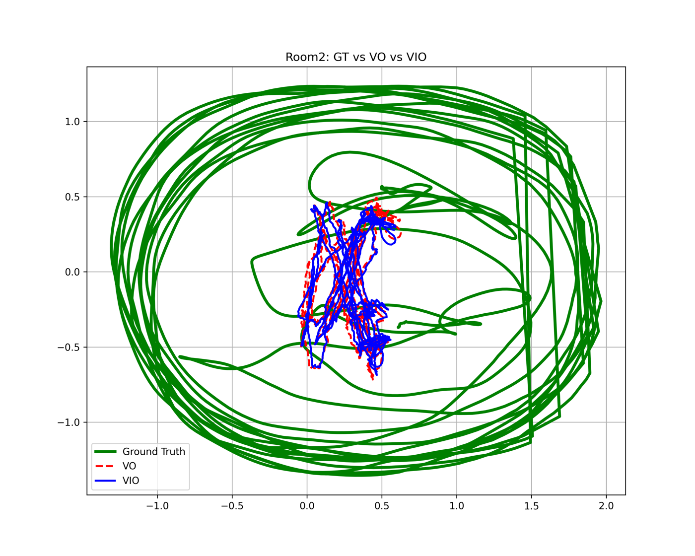
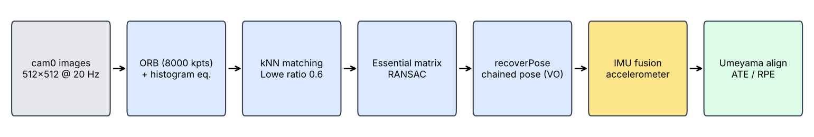
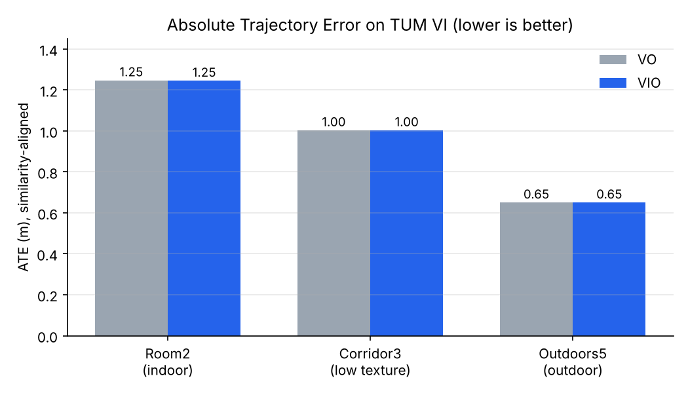
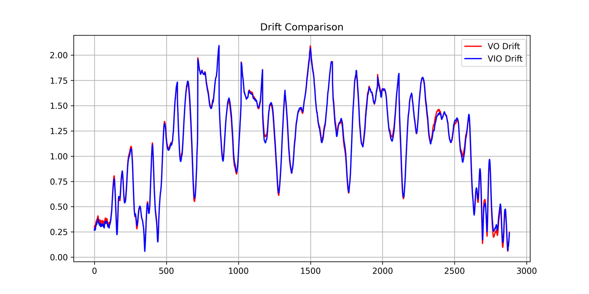
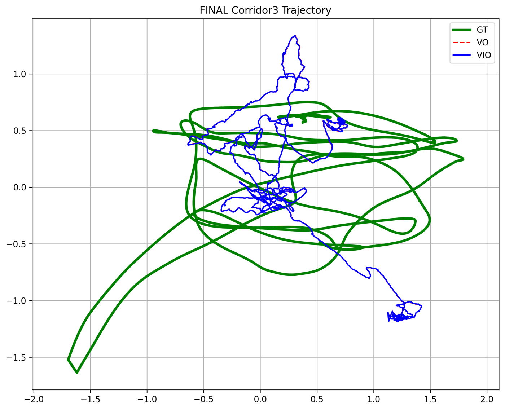
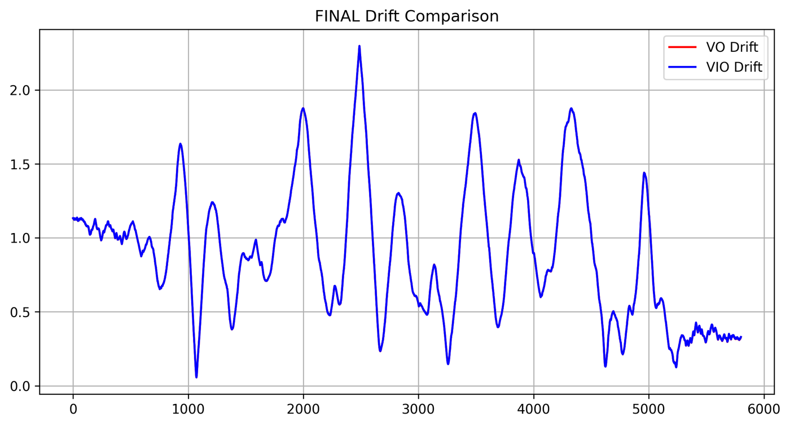
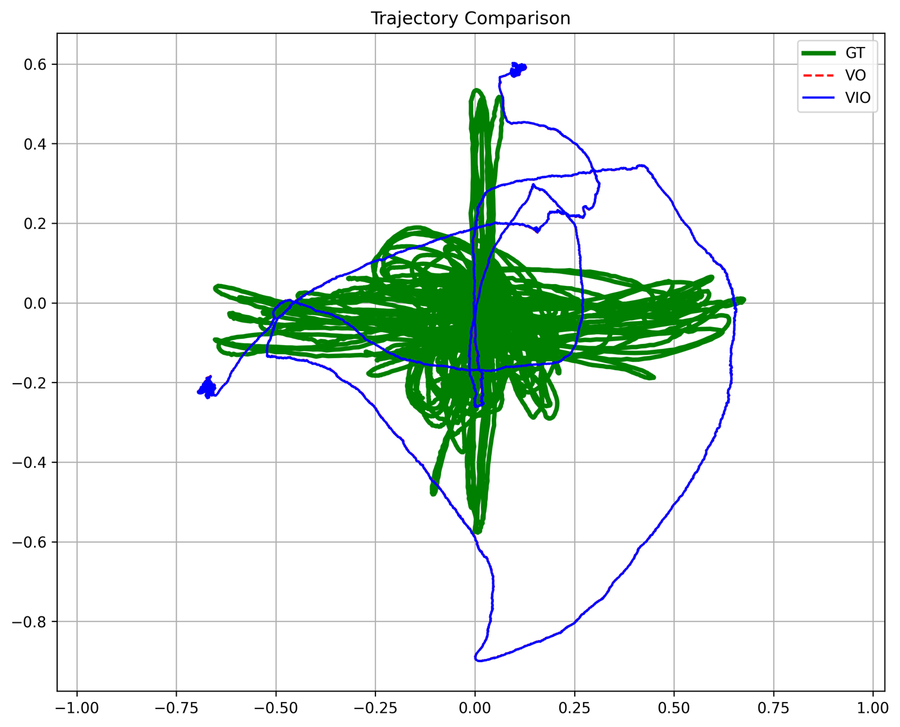
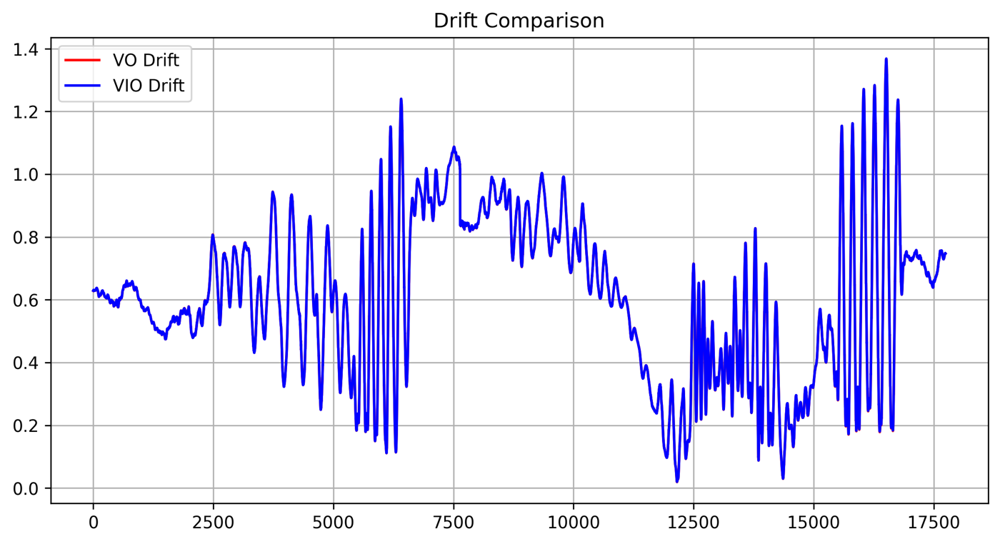

<div align="center">

# Monocular Visual and Visual-Inertial Odometry on TUM VI

**ORB-based monocular visual odometry with a lightweight IMU fusion, evaluated against motion-capture ground truth on three TUM VI sequences**

[](https://www.python.org/)
[](https://opencv.org/)
[](https://cvg.cit.tum.de/data/datasets/visual-inertial-dataset)
[](docs/report.pdf)



<sub>Room2: motion-capture ground truth (green) vs our VO (red) and VIO (blue) after similarity alignment.</sub>

</div>

---

## Highlights

- **Complete feature-based VO front end**: ORB keypoints (8,000 per frame) on histogram-equalised images, brute-force Hamming kNN matching with Lowe's ratio test, essential-matrix estimation with RANSAC, `recoverPose`, and pose chaining.
- **IMU fusion**: accelerometer readings are fused with the visual increments to smooth the trajectory.
- **Benchmark evaluation**: trajectories are aligned to motion-capture ground truth with a **Umeyama similarity transform** and scored with **ATE** and **RPE** on three sequences (indoor, low-texture corridor, outdoor).
- **Real time on CPU**: 33–42 FPS depending on the sequence.
- **Honest analysis**: the report explains why loosely coupled fusion gives only a marginal gain, and what is needed to fix it.
- Full write-up in IEEE format: **[docs/report.pdf](docs/report.pdf)**.

## Pipeline

<p align="center"></p>

## Results

<p align="center"></p>

| Sequence | Scene | VO ATE (m) | VIO ATE (m) | VO RPE | VIO RPE | FPS (VO / VIO) |
|---|---|---|---|---|---|---|
| `room2_512_16` | Indoor room, rich texture | 1.247 | 1.245 | 0.0968 | 0.0965 | 41 / 39 |
| `corridor3_512_16` | Corridor, low texture | 1.003 | 1.003 | 0.0102 | 0.0102 | 42 / 40 |
| `outdoors5_512_16` | Outdoor | ~0.65 | ~0.65 | – | – | 35 / 33 |

### Trajectories and drift

| | Trajectory (GT vs VO vs VIO) | Drift over time |
|---|---|---|
| **Room2** |  |  |
| **Corridor3** |  |  |
| **Outdoors5** |  |  |

### What the results show

- **Vision dominates.** VO and VIO are almost identical (≈0.2% ATE gain on Room2), so the current IMU term acts as a smoother, not a drift corrector.
- **Monocular scale is the main error source.** The estimated trajectories have the right local shape but the wrong extent and accumulate drift, which is expected without metric scale.
- **Texture matters.** The low-texture corridor is the hardest case for the ORB front end.
- **Next steps:** IMU pre-integration on SO(3) with bias estimation, a sliding-window optimiser (tightly coupled VIO), stereo triangulation for metric scale, and loop closure. Early stereo and back-end prototypes are in [`experiments/stereo_vio/`](experiments/stereo_vio/). They are work in progress and are not part of the reported results.

## Getting started

### 1. Install

```bash
git clone https://github.com/AkramSakly/Stereo-VIO-Project.git
cd Stereo-VIO-Project
python -m venv .venv && source .venv/bin/activate   # Windows: .venv\Scripts\activate
pip install -r requirements.txt
```

### 2. Download the data

Download the 512×512 **Euroc/DSO** exports of `room2`, `corridor3` and `outdoors5` from the [TUM VI dataset page](https://cvg.cit.tum.de/data/datasets/visual-inertial-dataset), and extract them like this:

```
data/
├── dataset-room2_512_16/mav0/{cam0,imu0,mocap0}
├── dataset-corridor3_512_16/mav0/...
└── dataset-outdoors5_512_16/mav0/...
```

### 3. Run

```bash
export TUMVI_ROOT=$PWD/data      # Windows (PowerShell): $env:TUMVI_ROOT="$PWD\data"
cd vo
python main_room2.py
python main_corridor3.py
python main_outdoor5.py
```

Each script prints the VO/VIO ATE and RPE, and saves the trajectory and drift plots to `vo/results/`.

## Repository structure

```
vo/
├── main_room2.py, main_corridor3.py, main_outdoor5.py   # one entry point per sequence
├── loader.py        # TUM VI images, IMU and ground-truth loading
├── vo.py            # MonocularVO: ORB + essential matrix + pose chaining
├── vio.py           # SimpleVIO: VO + accelerometer fusion
└── evaluate.py      # Umeyama alignment, ATE, RPE
docs/
├── report.pdf       # IEEE-format project report
└── images/          # figures used in this README
experiments/stereo_vio/   # work-in-progress stereo front end and optimisation back end
```

## Authors

**Akram Sakly** and **Oussama Garbaa Chtioui**, Master's VIBOT (Computer Vision), Université Bourgogne Europe, Le Creusot, France.

Contact: [Akram Sakly on GitHub](https://github.com/AkramSakly) · [LinkedIn](https://www.linkedin.com/in/akram-sakly)
