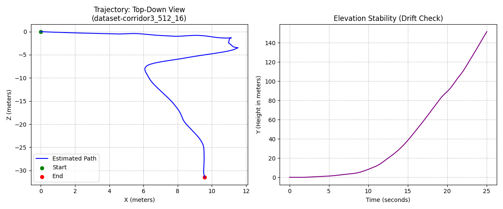

<div align="center">

# Visual and Visual-Inertial Odometry on TUM VI

**Monocular visual odometry with ORB features and a lightweight IMU fusion, evaluated against motion-capture ground truth on the TUM VI benchmark**

[](https://www.python.org/)
[](https://opencv.org/)
[](https://cvg.cit.tum.de/data/datasets/visual-inertial-dataset)



<sub>Estimated trajectory (top-down) and elevation drift on <code>dataset-corridor3_512_16</code>.</sub>

</div>

---

## Highlights

- **Feature-based monocular VO**: ORB keypoints, Hamming brute-force matching, Lowe's ratio test, essential matrix with RANSAC, and relative pose recovery.
- **IMU fusion**: accelerometer measurements are fused with the VO increments to smooth the trajectory.
- **Quantitative evaluation**: trajectories are aligned to ground truth with a similarity (Umeyama) alignment, then scored with **Absolute Trajectory Error (ATE)** and **Relative Pose Error (RPE)**.
- **Three TUM VI sequences** covering indoor, corridor and outdoor scenes.
- Written report in IEEE format: [`IEEE_Repport_Vo_VIO.pdf`](IEEE_Repport_Vo_VIO.pdf).

## Pipeline

```
cam0 images ──► ORB detection ──► kNN matching + ratio test ──► Essential matrix (RANSAC)
                                                                        │
                                                                        ▼
                                                    recoverPose ──► chained pose (VO)
                                                                        │
imu0 accelerometer ─────────────────────────────────► IMU fusion ──► VIO trajectory
                                                                        │
mocap0 ground truth ──► Umeyama alignment ──► ATE / RPE ──► plots + CSV
```

## Results

ATE after similarity alignment to motion-capture ground truth (metres, lower is better):

| Sequence | Scene | VO ATE | VIO ATE |
|---|---|---|---|
| `dataset-room2_512_16` | Indoor room | ~1.25 | ~1.25 |
| `dataset-corridor3_512_16` | Corridor | ~1.00 | ~1.00 |
| `dataset-outdoors5_512_16` | Outdoor | ~0.65 | ~0.65 |

**Discussion.** Monocular VO cannot observe metric scale, so translation drifts over long sequences (visible in the elevation plot above). The current IMU term acts as a smoothing filter and gives only a marginal change in ATE. A tightly coupled approach (IMU pre-integration with a sliding-window optimiser) is the natural next step; prototypes are in [`vo/imu_preintegration.py`](vo/imu_preintegration.py) and [`vo/sliding_window_vio.py`](vo/sliding_window_vio.py).

More figures (trajectories, error over time, accuracy summaries) are in the repository root, one set per sequence.

## Getting started

### 1. Install

```bash
git clone https://github.com/AkramSakly/Stereo-VIO-Project.git
cd Stereo-VIO-Project
python -m venv .venv && source .venv/bin/activate   # Windows: .venv\Scripts\activate
pip install -r requirements.txt
```

### 2. Download the data

Download the 512×512 **Euroc/DSO** exports of `room2`, `corridor3` and `outdoors5` from the [TUM VI dataset page](https://cvg.cit.tum.de/data/datasets/visual-inertial-dataset) and extract them so the layout is:

```
data/
├── dataset-room2_512_16/mav0/{cam0,imu0,mocap0}
├── dataset-corridor3_512_16/mav0/...
└── dataset-outdoors5_512_16/mav0/...
```

To keep the data elsewhere, set `TUMVI_ROOT` to the folder that contains the `dataset-*` folders.

### 3. Run

```bash
cd vo
export TUMVI_ROOT=../data        # Windows (PowerShell): $env:TUMVI_ROOT="..\data"
python main_room2.py
python main_corridor3.py
python main_outdoor5.py
```

Each script prints VO/VIO ATE and RPE and writes plots to `vo/results/`.

## Repository structure

```
vo/
├── main_room2.py, main_corridor3.py, main_outdoor5.py   # one entry point per sequence
├── loader.py              # TUM VI images, IMU and ground-truth loading
├── vo.py                  # MonocularVO: ORB + essential matrix + pose chaining
├── vio.py                 # SimpleVIO: VO + accelerometer fusion
├── evaluate.py            # Umeyama alignment, ATE, RPE
├── imu_preintegration.py  # IMU pre-integration (prototype)
├── sliding_window_vio.py  # sliding-window optimisation (prototype)
└── ekf_vio.py, vio_vins.py, vio_sw.py, optimizer.py      # alternative fusion experiments
*.png, *.csv, *.txt        # figures and estimated trajectories per sequence
IEEE_Repport_Vo_VIO.pdf    # project report
```

## Author

**Akram Sakly**, Research Master's in Computer Vision, Université de Bourgogne (Le Creusot, France)
[GitHub](https://github.com/AkramSakly) · [LinkedIn](https://www.linkedin.com/in/akram-sakly)
